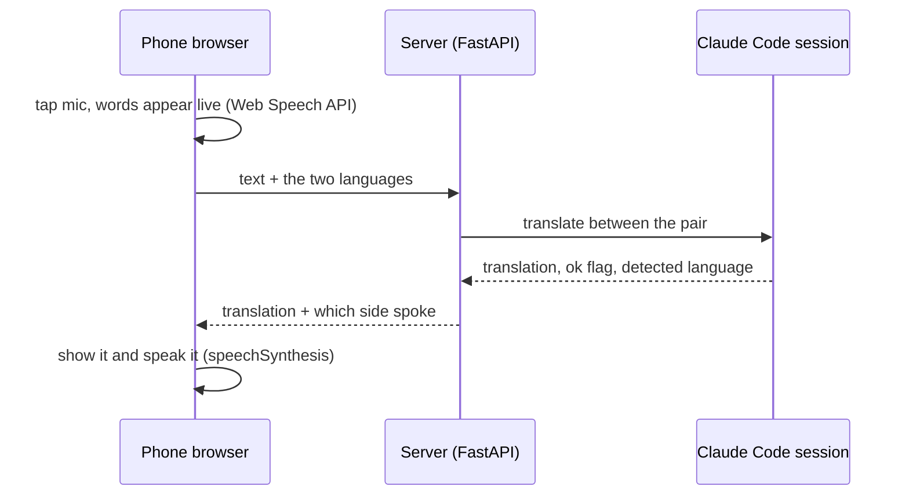
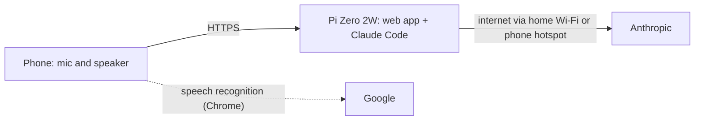
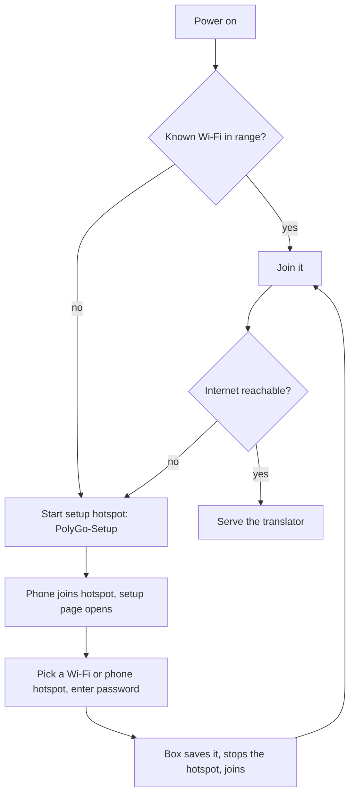

# PolyGo

A small real-time family translator. Two people who share no language talk through one web page on their phones: it listens, translates, shows the result and speaks it.

Built for **Assamese ⇄ German** (Hindi and English also work).
**Status:** working proof of concept on a Raspberry Pi 4 on a home network. Next: move it onto a Pi Zero 2W "belt box".

## How a translation works



- **Audio stays on the phone.** The browser does speech in and out, so the server only translates and can be tiny.
- **Language is auto-detected.** The page sends the two languages; the model decides which one the text is in and translates into the other.
- **Assamese** is written in Latin letters (default, how the family chats) or Assamese script, switchable in the header. Spoken Assamese is recognised as Bengali (`bn-IN`, nearly the same script) because Chrome's `as-IN` returned English-looking text; the model reads it by sound.
- **Unsure?** The model returns `ok:false` with an English rendering. The page warns and does not auto-play it.
- **One engine process**, one request at a time; restarts after 40 turns or a 45 s hang.

## Target: the belt box (Pi Zero 2W)



### Wi-Fi onboarding (like any IoT device)



The Zero has one Wi-Fi radio, so *setup mode* (box is the hotspot) and *normal mode* (box is a client) are separate. Home Wi-Fi is entered first; the real test is later, away from home, with a phone hotspot.

## Roadmap

- [x] Translation engine, web app, auto-detect, mic input, play button, Latin/script switch
- [x] Tested on Android and Windows over the home network
- [ ] **Zero 2W:** install it, measure memory and latency against the Pi 4 (about 2 s per sentence)
- [ ] **Wi-Fi onboarding** flow above, tested outside the house
- [ ] iPhone test (needs HTTPS)
- [x] Access passcode (shared family passcode, fail closed)
- [ ] Family glossary: real phrases, names and spellings (`glossary.txt`, private)
- [x] Public HTTPS link (Tailscale Funnel), checked from the internet: valid certificate, passcode required
- [ ] iPhone mic test over the public link
- [ ] Belt enclosure

## Open questions

| Question | Why it matters |
|---|---|
| Does the Zero 2W have enough memory and speed? | 512 MB RAM. The Claude process alone used about 250 MB on the Pi 4. Not measured on a Zero yet. |
| **HTTPS for the microphone** | Browsers block the mic on plain `http`. This is the same problem whether the phone talks to the box directly or through a hotspot. Options: a tunnel, or a trusted certificate. Decide after the latency test. |
| Which onboarding tool? | Candidates: balena wifi-connect, comitup, RaspAP. Not evaluated. |
| Claude login on a portable device | The login lives on the box; losing it means revoking it. |
| Assamese quality | Spot-checked only, not measured. Treat the "unsure" flag as a hint, not a guarantee. |

## Run it

Needs Python 3.11+ and the [Claude Code](https://claude.com/claude-code) CLI, logged in, on the machine that runs the server.

```bash
python3 -m venv venv && ./venv/bin/pip install -r requirements.txt
AT_MODEL=claude-sonnet-5-5 ./venv/bin/uvicorn server:app --host 0.0.0.0 --port 8765
```

Create the passcode first (the server refuses to translate without one), then open `http://<host>:8765`:

```bash
echo "pick-a-passcode-here" > passcode.txt && chmod 600 passcode.txt   # git-ignored
```

Optional: copy `glossary.example.txt` to `glossary.txt` and fill in your family's words, names and example sentences; the translator follows them over its own guesses (also git-ignored). A systemd user unit is in `deploy/polygo-api.service`. For mic testing on Chrome over plain `http`, allow the address in `chrome://flags/#unsafely-treat-insecure-origin-as-secure`.

## Public HTTPS link (Tailscale Funnel)

The microphone needs HTTPS, so the service is published with [Tailscale Funnel](https://tailscale.com/kb/1223/funnel): a free `*.ts.net` address with a real certificate, no domain and no open router port.

```bash
# on the Pi, once (needs sudo): install Tailscale, then log in and let your user control it
curl -fsSL https://tailscale.com/install.sh | sh
sudo tailscale up                      # prints a login link
sudo tailscale set --operator=$USER
# then, without sudo
tailscale funnel --bg 8765             # first run prints a link to enable Funnel/HTTPS in the admin page
```

Anyone on the internet can open the address, so the passcode is the only gate. The first lookup of a brand-new name can take a while to appear in public DNS; try again from another network if it does not resolve.

## Limits

- **Passcode, not accounts:** the page is public but every translate/reset call needs the family passcode (header `X-Passcode`), asked once per phone. Wrong guesses are slowed to about one per second overall; a correct one is never slowed. If no passcode file exists, the API refuses everything (fail closed). It is one shared secret, so treat it like a Wi-Fi password.
- Chrome's recogniser sends audio to Google. Speech output uses the phone's installed voices; most phones have no Assamese voice, so Latin-letter Assamese is read by an Indian-English voice.
- The engine is the Claude Code CLI, not the API. `translator.py` is the only file that touches it, so it can be swapped. Check Anthropic's current terms for how you may use it.
- `MemoryMax` in the unit file is not enforced on every Pi setup.
