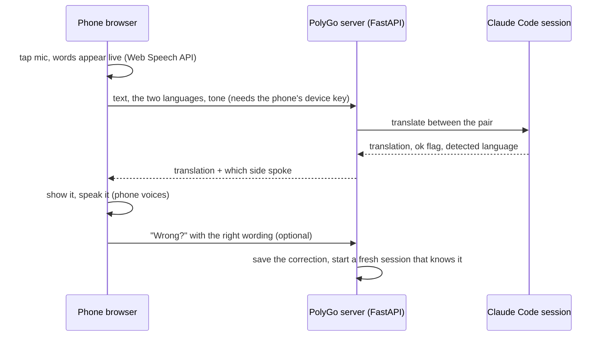
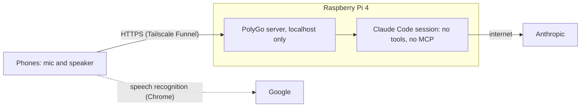
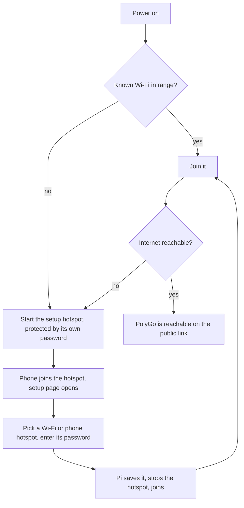

# PolyGo

A small real-time family translator. Two people who share no language talk through one web page on their phones: it listens, translates, shows the result and speaks it. Built for **Assamese ⇄ German** (Hindi and English also work).

**Status:** working. Runs on a dedicated Raspberry Pi 4, reachable from anywhere over a public HTTPS link; only phones that an admin has set up get in. Next: a Wi-Fi setup hotspot so the Pi can travel, and the iPhone test.

## How a translation works





## What it does

- **Auto-detects** which of the two languages was said and translates into the other.
- **Tone** dropdown: formal (Assamese *apuni*, German *Sie*), informal (*tumi*, *du*) or match the speaker. The intimate forms *tur/tar/tahator* are never used.
- **Assamese** is shown in Latin letters (how the family chats), or in script via a header switch. If the phone has an Assamese or Bengali voice, it speaks the script version; otherwise an Indian-English voice reads the Latin text. Spoken Assamese is recognised as Bengali (`bn-IN`, almost the same script) because Chrome's `as-IN` returned English-looking text; the model reads it by sound.
- **Unsure?** The model says so (`ok:false`) and answers in English; the page warns and does not auto-play it.
- **Family glossary** (`glossary.txt`, private): names, relatives, time words, grammar rules (*tumi … asa*, *apuni … ase*) and example sentences the model must follow.
- **Learns as we go:** a **Wrong?** button on every answer lets anyone type the right wording. It is saved (`corrections.jsonl`, private, newest 200 kept), a fresh session picks it up, and **Settings → Saved corrections** lists and deletes them.
- **One simple view** for everyone: two huge mic buttons named in each language (Axomiya, Deutsch), a typing box with a send arrow, big text, a banner that says Listening / Translating / Speaking, a **Make a session** button and a **⋯** menu next to the title. The menu has zoom (🔍 − / 🔍 +), **Change language from / to**, Invite someone, New conversation, and *More settings* (tone, Assamese in Latin letters or script, speaking speed, voice-recognition choices, saved corrections). Admins also get **Invite another admin** and **Devices**. Answers are always spoken. There is no separate "full view" any more.
- **Devices and invites:** every phone is a *device* with its own random key, kept in an HttpOnly cookie; the server stores only a hash. The **first admin** claims the server with the passcode (`passcode.txt`), once, while no admin exists. After that the passcode opens nothing. An admin makes a named invite (⋯ → **Invite someone**: name, language `en/de/hi/as`, tone, and family = link never expires / friend = N days of access / admin = link valid 24 h) and shares the link `/#i=<token>` or its QR. The token is 128 random bits, stored only as a hash, works once, and travels after the `#` (never sent to a server). Opening it enrols the phone, which takes over the languages and tone of the invite; afterwards the plain address recognises it. **Devices** lists phones and waiting invites with two-tap Remove / Cancel; the server refuses to remove the last admin, and a banner nags until a second admin exists. If every admin phone is lost: `python devices.py recovery` on the Pi prints a fresh one-time admin link. State lives in `devices.json` (private, git-ignored, mode 600). The QR is drawn by the server (`/api/qr`, `segno`), never by an outside service.
- **Stats (admins only):** ⋯ → **Stats** shows messages today / 7 days / 30 days, a 14-day column chart (only the busiest day and today are labelled, hover or focus any column for its number, a table view lists them all), each phone's messages and Claude tokens for the week, the translator's answers, average time, slow answers (over 8 s), errors and restarts, open sessions, and the Pi's memory, temperature, load, disk and uptime. **Counters only**: counts, characters and token numbers, never the words that were said. They live in memory and are saved to `stats.json` (private, git-ignored) every 5 minutes and on shutdown. The server refuses the numbers to anyone who is not an admin.
- **Shared conversations (rooms):** **Make a session** starts a room and shows its link and QR code. Each phone joins in its own language and every message arrives translated into each person's language, so different languages can mix in one conversation. A message goes to the translator once, into all needed languages in a single call. In a room a phone has **one mic** (its own language), the page text is in that language (English, German, Hindi, and Assamese in Latin letters, the last one a draft), other people's messages are spoken (queued, not cut off), and a language dropdown plus a 👥 people screen (share, size, leave, end for everyone) are always at hand.
  - *Joining:* the link says `#room=…` (optionally the person's language `l=` and name `n=`). A phone that was never set up sees "ask for a link" first (an admin invites it); the join screen then pre-selects the language from the link, else from the phone's first language setting (German, Hindi, Assamese are trusted, English is not and asks once with four big buttons), and its Join tap also unlocks speech on iPhones. Reloading the page resumes the conversation as the same person.
  - *Rules:* a link lasts 24 h; 2 to 10 phones (default 4, the creator can change it, ceiling `POLYGO_ROOM_MAX`); latecomers see nothing from before they joined; everything stays in memory only (never on disk, a restart ends all rooms); at most 8 messages per person per 30 s. Delivery is long-polling (`/api/rooms/{id}/events`), so a phone that drops out simply asks again from where it was; the screen is kept awake where the browser allows it.
- **Light or dark:** the page follows the phone's own setting; ⋯ → **Appearance** lets a phone pin Light or Dark (remembered on that phone only).
- **Home-screen icon:** a web app manifest (`display: browser`) and icons, so a phone can keep a PolyGo shortcut. It opens in the normal browser on purpose, so the device key (cookie) and speech recognition keep working; Chrome therefore says "This app cannot be installed" and offers **Create shortcut**, which is the right choice. iPhone: Safari → Share → Add to Home Screen. ⋯ → More settings → "Put PolyGo on the home screen" shows the steps.
- **Login keep-alive:** see [Keeping the Claude login alive](#keeping-the-claude-login-alive).
- Mic, play button, speaking speed, one-request-at-a-time queue, automatic restart after 40 turns or a hang.

## Setup

Needs Python 3.11+ and the [Claude Code](https://claude.com/claude-code) CLI, logged in, on the machine that runs the server.

```bash
python3 -m venv venv && ./venv/bin/pip install -r requirements.txt
echo "pick-a-passcode" > passcode.txt && chmod 600 passcode.txt     # only used once, to claim the first admin (open the page and follow the screen)
POLYGO_MODEL=claude-sonnet-5-5 ./venv/bin/uvicorn server:app --host 127.0.0.1 --port 8765
```

A systemd user unit is in `deploy/polygo-api.service`. Private, git-ignored files: `passcode.txt`, `devices.json`, `stats.json`, `keepalive.json`, `glossary.txt` (start from `glossary.example.txt`), `corrections.jsonl`.

### Public HTTPS link (Tailscale Funnel)

Browsers only allow the microphone on HTTPS. [Tailscale Funnel](https://tailscale.com/kb/1223/funnel) gives a free `*.ts.net` address with a real certificate, no domain and no open router port.

```bash
# on the Pi, once (needs sudo)
curl -fsSL https://tailscale.com/install.sh | sh
sudo tailscale up                      # prints a login link
sudo tailscale set --operator=$USER
# then, without sudo
tailscale funnel --bg 8765             # first run prints a link to enable Funnel/HTTPS in the admin page
```

A brand-new name can take a while to show up in public DNS. Before travelling, disable key expiry for the device in the Tailscale admin page.

## Keeping the Claude login alive

The engine is the Claude Code CLI signed in with a subscription. Its token is renewed each time it is used (access token about 8 hours, renewal token about 8 days, rolling), stored in `~/.claude/.credentials.json` on the Pi. If PolyGo sits unused for about a week the renewal can lapse, and then every translation fails with the generic "Could not translate" message.

**Keep-alive (`keepalive.py`, automatic).** If a whole day passes with no successful Claude call, the server makes one tiny Haiku call (about 550 tokens, a hundredth of a cent). It checks 60 seconds after start-up and every 30 minutes. A real translation counts as use, so on a normal day it never fires. The result is in ⋯ → **Stats** → Translator → **Claude login** ("working, last used 3 h ago", or "PROBLEM: …" plus a hint if it looks like a login problem). Settings (environment): `POLYGO_KEEPALIVE_HOURS` (24), `POLYGO_KEEPALIVE_CHECK_SECONDS` (1800), `POLYGO_KEEPALIVE_MODEL` (`claude-haiku-5-5`). State is a few numbers in `keepalive.json`. `python tests/keepalive_test.py` runs its 26 checks.

### If the login has expired: sign in again from your phone

You need the Pi online (at home Wi-Fi or on a phone hotspot, it joins Tailscale by itself) and, on the phone, the Tailscale app signed in to the same account plus any SSH app (Termius, Blink, JuiceSSH, ...). The public link only serves the web page, not SSH, so this is only reachable from your own tailnet.

1. Turn Tailscale on, on the phone.
2. In the SSH app, connect to host `polygo` (or its Tailscale address `100.76.2.93`), user `spidey`, with the Pi's password. (Password login is enabled on the Pi. Your PC's key `~/.ssh/polygo_zero` is on the PC only; you do not need to copy it to the phone. Optional upgrade: `sudo tailscale set --ssh` on the Pi turns on Tailscale SSH, which needs no password or key from a phone on the tailnet. It is off today.)
3. Check what is wrong: `~/.npm-global/bin/claude auth status` (it shows `"loggedIn": true` when the login is fine)
4. Sign in again: run `~/.npm-global/bin/claude`, type `/login` and pick the Claude account (subscription) sign-in if it asks. It prints a web address. Open it in the phone's browser, sign in to Claude, copy the code it shows and paste it into the SSH app. Then `/exit`.
5. Make the server pick it up: `systemctl --user restart polygo-api`
6. Check: ⋯ → Stats → Claude login should say "working", or send a test message.

If the Pi cannot be reached at all: check the Pi has power and internet, and that its name shows up as online in the Tailscale app. Rehearse steps 1 to 3 once on your phone's hotspot before a trip.

**Lost every admin phone?** On the Pi: `cd ~/polygo && ./venv/bin/python devices.py recovery` prints a one-time admin link (`<address>/#i=<token>`).

**Long-lived token (not used).** `claude setup-token` can make a token that is said to last about a year (set as `CLAUDE_CODE_OAUTH_TOKEN`). We did not switch to it: open bug reports describe 401 errors with such tokens, including in long-running processes, and PolyGo is one long-running process. The self-renewing login plus the keep-alive is the safer setup. If you ever try it, test it with a real session first and keep the normal login as the fallback.

### Deploying changes

The Pi has no git. Copy changed files from the PC and restart:

```bash
scp -i ~/.ssh/polygo_zero server.py keepalive.py spidey@polygo.local:polygo/
scp -i ~/.ssh/polygo_zero static/* spidey@polygo.local:polygo/static/
ssh -i ~/.ssh/polygo_zero spidey@polygo.local 'systemctl --user restart polygo-api'
```

Tests run from the PC (the Pi has no `tests/` folder).

## Security

| Threat | Protection |
|---|---|
| Strangers use the translator | Every translate, reset, correction, room and QR call needs a device key (only a hash is stored; keys are 256 random bits in an HttpOnly, Secure, SameSite=Strict cookie). Wrong keys, links and passcode guesses are serialised to about one per second overall. The passcode only claims the first admin and only while none exists. |
| Someone on the same Wi-Fi reaches the app | It listens on `127.0.0.1` only; only the Funnel link reaches it. |
| The model is tricked by the text it translates | The Claude session starts with no tools, no MCP servers and no slash commands, so it can only produce text. Injection attempts are translated, not obeyed. |
| Hostile text in a correction | Corrections are flattened to one line, length-capped, quoted and labelled as data before they reach the model; only passcode holders can save them. |
| API docs reveal the API | `/docs`, `/redoc`, `/openapi.json` are disabled. |
| A room link leaks | The link alone does not get anyone in: every room call needs a set-up phone's device key too. A room id is 128 random bits, a room dies after 24 h or when its creator ends it, size and message rate are capped, and nothing is stored on disk. |
| An invite link leaks | It works once, on one phone, and carries no secret except its own token. If the wrong person opens it first, the real person is told it was used and you see an unknown device under **Devices** and remove it. Admin links expire after 24 h; a lost or stolen phone is removed by an admin in two taps. Link-preview bots cannot use it up: the token sits after the `#` and is redeemed by a POST from the page. |
| The stats expose what people say | They cannot: only counts are stored (messages, characters, token numbers, answer times), never text. Only admins can read them (the server returns 403 to other phones, 401 to unknown ones). |

Honest limits: someone who steals an unlocked phone has that phone's access until an admin removes it. An iPhone that opens a link inside WhatsApp's built-in browser keeps the key there, not in Safari (open links in Safari or scan the QR). The Claude login on the Pi cannot be restricted to "translator only"; if the Pi is lost, sign out all Claude sessions and remove the device in Tailscale. Chrome's speech recogniser sends audio to Google. The engine is the Claude Code CLI, not the API; `translator.py` is the only file that touches it, so it can be swapped (check Anthropic's current terms for how you may use it).

## Roadmap

- [x] Translation, tone, glossary, mic, voices, public HTTPS link, "Wrong?" corrections
- [x] Parent-friendly: one simple view, big named mic buttons, typing box, zoom, language dropdown, page texts in English, German, Hindi and Axomiya (Latin letters, draft)
- [x] Shared conversations (sessions): rooms with joining, capacity, expiry, per-person languages and live delivery
- [x] Devices and invites: a key per phone, single-use invite links and QR, family / friend / admin, device list with remove, recovery command; the shared passcode is retired
- [x] Admin stats panel (counters only), Claude login keep-alive, light / dark / automatic appearance, home-screen icon
- [ ] To check on real phones: the first real session with the family, the microphone and voices in a room, iPhone speech and screen-on behaviour, Android voices, the Axomiya texts (draft) by a speaker, the German by a speaker, the Hindi
- [ ] **Wi-Fi setup hotspot**: installed (comitup, `deploy/set-hotspot.sh`); the outdoor test is still to do
- [ ] Before travelling: turn off the Tailscale key expiry for the Pi; rehearse the phone login above; back up `devices.json`, `glossary.txt`, `corrections.jsonl`, `stats.json` (they exist only on the Pi)
- [ ] Ideas, only if testing shows a need: clearer errors (such as the usage limit), **quick phrases**, an in-app-browser hint, per-device message limits, tailnet-only access instead of the public link
- [ ] Parked: commercial use (would need the Claude API or commercial terms, not a subscription), a Pi Zero 2W belt box (too little RAM for the Claude CLI)

### Planned: Wi-Fi setup hotspot (comitup)

The Pi only needs internet, from anywhere; phones reach it through the public link with their own data. When it finds no Wi-Fi it knows, it opens a password-protected hotspot, like an IoT device.


