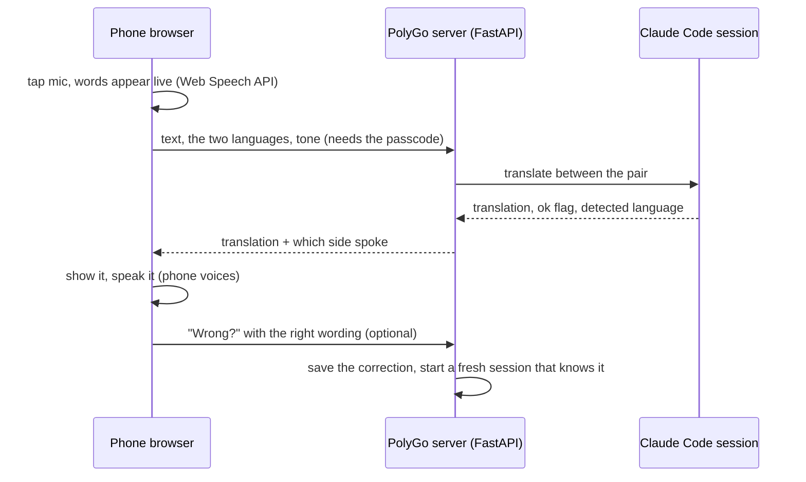
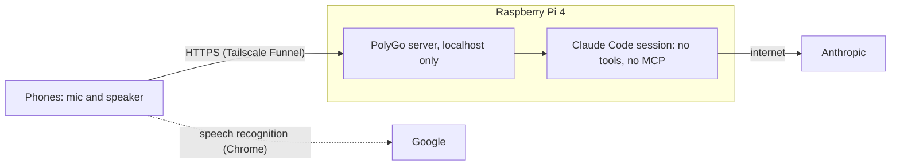
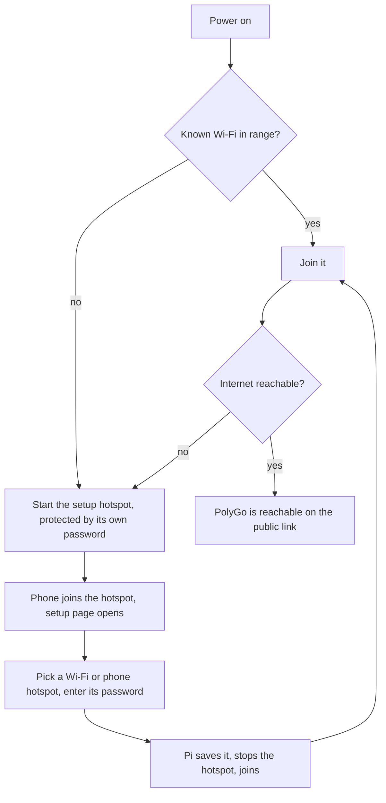

# PolyGo

A small real-time family translator. Two people who share no language talk through one web page on their phones: it listens, translates, shows the result and speaks it. Built for **Assamese ⇄ German** (Hindi and English also work).

**Status:** working. Runs on a dedicated Raspberry Pi 4, reachable from anywhere over a public HTTPS link behind a family passcode. Next: a Wi-Fi setup hotspot so the Pi can travel, and the iPhone test.

## How a translation works





## What it does

- **Auto-detects** which of the two languages was said and translates into the other.
- **Tone** dropdown: formal (Assamese *apuni*, German *Sie*), informal (*tumi*, *du*) or match the speaker. The intimate forms *tur/tar/tahator* are never used.
- **Assamese** is shown in Latin letters (how the family chats), or in script via a header switch. If the phone has an Assamese or Bengali voice, it speaks the script version; otherwise an Indian-English voice reads the Latin text. Spoken Assamese is recognised as Bengali (`bn-IN`, almost the same script) because Chrome's `as-IN` returned English-looking text; the model reads it by sound.
- **Unsure?** The model says so (`ok:false`) and answers in English; the page warns and does not auto-play it.
- **Family glossary** (`glossary.txt`, private): names, relatives, time words, grammar rules (*tumi … asa*, *apuni … ase*) and example sentences the model must follow.
- **Learns as we go:** a **Wrong?** button on every answer lets anyone type the right wording. It is saved (`corrections.jsonl`, private, newest 200 kept), a fresh session picks it up, and **Settings → Saved corrections** lists and deletes them.
- Mic, auto-play, play button, speaking speed, one-request-at-a-time queue, automatic restart after 40 turns or a hang.

## Setup

Needs Python 3.11+ and the [Claude Code](https://claude.com/claude-code) CLI, logged in, on the machine that runs the server.

```bash
python3 -m venv venv && ./venv/bin/pip install -r requirements.txt
echo "pick-a-passcode" > passcode.txt && chmod 600 passcode.txt     # the server refuses to work without it
POLYGO_MODEL=claude-sonnet-5-5 ./venv/bin/uvicorn server:app --host 127.0.0.1 --port 8765
```

A systemd user unit is in `deploy/polygo-api.service`. Private, git-ignored files: `passcode.txt`, `glossary.txt` (start from `glossary.example.txt`), `corrections.jsonl`.

### Public HTTPS link (Tailscale Funnel)

Browsers only allow the microphone on HTTPS. [Tailscale Funnel](https://tailscale.com/kb/1223/funnel) gives a free `*.ts.net` address with a real certificate, no domain and no open router port.

```bash
# on the Pi, once (needs sudo)
curl -fsSL https://tailscale.com/install.sh | sh
sudo tailscale up                      # prints a login link
sudo tailscale set --operator=$USER
# then, without sudo
tailscale funnel --bg 8765             # first run prints a link to enable Funnel/HTTPS in the admin page
```

A brand-new name can take a while to show up in public DNS. Before travelling, disable key expiry for the device in the Tailscale admin page.

## Security

| Threat | Protection |
|---|---|
| Strangers use the translator | Every translate, reset and correction call needs the family passcode (constant-time check; wrong guesses are serialised to about one per second overall, a correct one is never slowed). No passcode file means the API refuses everything. |
| Someone on the same Wi-Fi reaches the app | It listens on `127.0.0.1` only; only the Funnel link reaches it. |
| The model is tricked by the text it translates | The Claude session starts with no tools, no MCP servers and no slash commands, so it can only produce text. Injection attempts are translated, not obeyed. |
| Hostile text in a correction | Corrections are flattened to one line, length-capped, quoted and labelled as data before they reach the model; only passcode holders can save them. |
| API docs reveal the API | `/docs`, `/redoc`, `/openapi.json` are disabled. |

Honest limits: the passcode is one shared secret, so treat it like a Wi-Fi password. The Claude login on the Pi cannot be restricted to "translator only"; if the Pi is lost, sign out all Claude sessions and remove the device in Tailscale. Chrome's speech recogniser sends audio to Google. The engine is the Claude Code CLI, not the API; `translator.py` is the only file that touches it, so it can be swapped (check Anthropic's current terms for how you may use it).

## Roadmap

- [x] Translation, tone, glossary, mic, voices, passcode, public HTTPS link, "Wrong?" corrections
- [ ] iPhone test over the public link (mic, speech, auto-play)
- [ ] Android: check which voices the phone offers (the page shows the voice used)
- [ ] **Wi-Fi setup hotspot** so the Pi can join new networks (flow below), protected by its own password
- [ ] Optional: tailnet-only access instead of the public link; firewall
- [ ] Parked: a Pi Zero 2W belt box (too little RAM for the Claude CLI), enclosure

### Planned: Wi-Fi setup hotspot (comitup)

The Pi only needs internet, from anywhere; phones reach it through the public link with their own data. When it finds no Wi-Fi it knows, it opens a password-protected hotspot, like an IoT device.


